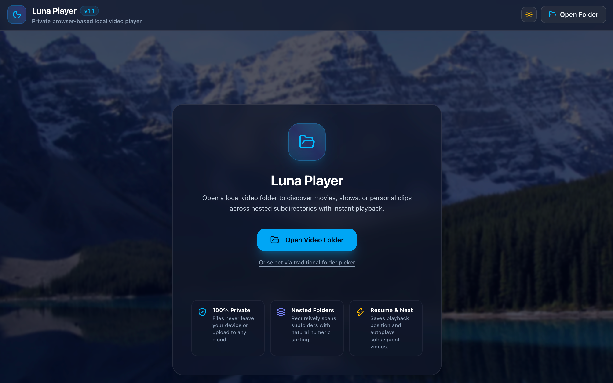

<p align="center">
  
</p>

<h1 align="center">Luna Player</h1>

<p align="center">
  <strong>A modern, lightweight, private browser-based local video player.</strong>
</p>

<p align="center">
  <a href="https://player.jinleo.dev"><strong>Live Demo: player.jinleo.dev</strong></a>
</p>

Open any local folder or set of video files, automatically discover videos across nested subdirectories, browse them in a hierarchical playlist with natural sorting and search, and play them directly in your browser.

**Core Philosophy:** Simple, private, responsive, and easy to use.

---

## 📸 Preview


### Modes & Layouts

| Dark Mode | Theater Mode |
| :---: | :---: |
|  |  |

---

## ✨ Features

- **🔒 100% Client-Side & Private**
  - Zero backend services, zero tracking, and zero cloud uploads.
  - Video streams run strictly in-browser via Blob Object URLs from local disk handles or selected files.
- **📂 Local Folder & Multi-File Selection**
  - Unified **Open Videos** control (defaults to **Open Folder** on Windows/macOS desktop and **Open Files** on iPad) with a `...` menu to switch between **Open Folder** and **Open Files** anytime.
  - Uses the **File System Access API** (`showDirectoryPicker`) where supported, with `webkitdirectory` and `<input type="file" multiple>` fallbacks.
  - Filters supported video formats (`.mp4`, `.webm`, `.mkv`, `.mov`, `.avi`, `.m4v`, `.ogv`) and prunes empty folders while preserving nested directory structure.
- **🔢 Recursive Playlists, Search, Filtering & Natural Sorting**
  - Intuitively sorts video titles numerically (e.g., `Episode 1`, `Episode 2`, ..., `Episode 10`) with deterministic Depth-First Search (DFS) ordering across nested folders.
  - Collapsible search bar filters episodes by title or relative path with live match counts and Expand/Collapse All folder controls.
- **⌨️ Keyboard Controls & On-Screen Feedback HUD**
  - Full keyboard control for playback, three seek distances, start/end jumps, playback speed, volume, mute, and fullscreen.
  - Centered, non-blocking Feedback HUD pill shows play/pause, accumulated seek deltas (`1000ms` window), applied playback speed, and volume/mute state (`600ms` display, `400ms` fade).
  - Shortcuts automatically pause while typing in search, adjusting sliders, navigating menus, or interacting with modal dialogs.
- **⚙️ Configurable Settings & Persistence**
  - Header **Settings** dialog lets you customize playback speed, seek distances, and volume step with inline validation and `localStorage` persistence (`luna_player_settings_v1`).
  - Preserves resume positions per library/file and remembers theme, volume, mute, autoplay, and playlist sidebar state across sessions.
- **🎭 Theater, Fullscreen, Collapsible Playlist & Autoplay Next**
  - Auto-hiding floating video controls (`2.5s` while playing, `4s` while paused), collapsible desktop Playlist sidebar, full-viewport **Theater Mode**, native **Fullscreen**, and **Autoplay Next**.
- **🎵 Batch Audio Extraction**
  - Extract audio tracks locally using **FFmpeg.wasm** to **MP3 (128 kbps)** or **WebM / Opus (64 kbps)**, preserving nested folder structure and skipping existing outputs.
  - Source files over **2 GB** are skipped, and browser WebAssembly memory limits may affect very large files.
- **🎨 Glassmorphic Themes & Scenic Backdrop**
  - Light and Dark themes with frosted-glass panels over a Moraine Lake & alpine backdrop.

---

## ⌨️ Keyboard Shortcuts

All 15 Luna V default shortcuts are supported alongside Luna Player's `K`, `M`, and `F` aliases:

| Category | Shortcut | Action |
| :--- | :--- | :--- |
| **Playback** | `Space` or `K` | Play / Pause |
| | `F` | Toggle Fullscreen |
| **Seeking** | `,` / `.` | Fine seek backward / forward (default `1s`) |
| | `←` / `→` | Medium seek backward / forward (default `5s`) |
| | `↑` / `↓` | Large seek backward / forward (default `30s`) |
| | `<` / `>` | Jump to Start / near End |
| **Speed** | `[` / `]` | Decrease / increase speed (default `0.25×` step) |
| | `\` | Toggle `1×` / maximum speed (default `5×`) |
| **Volume** | `;` / `'` | Decrease / increase volume (default `5%` step) |
| | `Enter` or `M` | Mute / Unmute (restores previous audible volume) |

---

## ⚙️ Settings

Click the **Settings** icon in the header to view the read-only shortcut reference and customize seven numeric control parameters:

- **Playback Speed**: Step (`0.05`–`1×`, default `0.25×`), Minimum & Maximum (`0.1`–`10×`, defaults `0.25×`–`5×`; range must include `1×` with Minimum < Maximum).
- **Seeking**: Fine Seek (`0.1`–`5s`, default `1s`), Medium Seek (`1`–`60s`, default `5s`), Large Seek (`5`–`300s`, default `30s`; must satisfy Fine < Medium < Large).
- **Volume**: Volume Step (`> 0%` to `100%`, default `5%`).

**Save** validates and persists changes to `localStorage`, **Cancel** (or `Esc`) discards edits, and **Reset to Defaults** restores the default values in the form until you click **Save**.

---

## 🛠️ Technology Stack

- **Framework**: [React 19](https://react.dev/) + [TypeScript](https://www.typescriptlang.org/)
- **Build Tool**: [Vite 8](https://vitejs.dev/)
- **Styling**: [Tailwind CSS 4](https://tailwindcss.com/)
- **Icons**: [Lucide React](https://lucide.dev/)
- **Storage**: IndexedDB & LocalStorage
- **Media & APIs**: HTML5 Video API, File System Access API, [FFmpeg.wasm](https://ffmpegwasm.netlify.app/)
- **Testing**: [Vitest](https://vitest.dev/) (Unit) & [Playwright Test](https://playwright.dev/) (Chromium E2E)

---

## 🌐 Browser Compatibility

- **Desktop Chrome / Microsoft Edge (Recommended)**: Full support for **Open Folder** (`showDirectoryPicker`), persistent folder permissions, **Open Files**, keyboard controls, and batch **Audio Extraction** directly to an output folder.
- **Other Desktop Browsers**: Can load folders via `webkitdirectory` fallback or individual files via **Open Files**, though direct-to-folder audio extraction output requires the File System Access API.
- **iPad Safari**: Supports multi-file video playback via **Open Files** (`Open Videos` defaults to file selection on iPad). Batch audio extraction to a local folder is unavailable on iPad Safari because `showDirectoryPicker` is not supported.

---

## 🚀 Getting Started

### Prerequisites

- [Node.js](https://nodejs.org/) (`^20.19.0` or `>=22.12.0`, required by Vite 8)
- `npm` (or `pnpm` / `yarn`)

### Local Development

Install dependencies and start the local development server:

```bash
npm install
npm run dev
```

Open `http://localhost:5173` in your browser.

### Production Build

Create an optimized static production build:

```bash
npm run build
```

Preview the production build locally:

```bash
npm run preview
```

---

## 🧪 Testing

### Unit Tests (Vitest)

Run the Vitest unit test suite covering natural sorting, video tree construction and DFS flattening, theme persistence, playback progress and control settings storage/validation, keyboard shortcut resolution and focus guards, Feedback HUD timing/accumulation, and FFmpeg.wasm audio extraction:

```bash
npm test
```

### End-to-End Tests (Playwright)

Run the Chromium E2E test suite:

```bash
npm run test:e2e
```

> **Note:** Some selectors in `tests/e2e/` still reference earlier UI labels (such as `Open Video Folder` before it became `Open Videos`) and have not been re-verified after the recent UI and keyboard-control updates.

---

## 📁 Project Structure

```
luna-player/
├── docs/
│   ├── branding/              # Authoritative mascot design reference
│   └── screenshots/           # Application screenshots (overview, dark, theater)
├── public/
│   ├── favicon.svg            # Official vector mascot favicon
│   └── assets/                # Static alpine photographic backdrop
├── src/
│   ├── assets/                # Bundled backdrop assets
│   ├── components/            # UI components (Header, VideoPlayer, FeedbackHud, SettingsModal, Playlist, etc.)
│   ├── config/                # Default control settings and validation limits
│   ├── hooks/                 # Custom React hooks (usePlayback, useTheme, useVideoLibrary)
│   ├── services/              # File system, directory traversal, audio extraction & storage
│   ├── types/                 # TypeScript interfaces
│   ├── utils/                 # Natural sort, tree traversal, shortcuts, HUD & settings draft helpers
│   ├── App.tsx                # Main application layout and state wiring
│   ├── index.css              # Tailwind utilities, class variants, glassmorphism
│   └── main.tsx               # React application entry point
├── tests/
│   ├── e2e/                   # Playwright E2E suites
│   ├── fixtures/              # Sample local library test video fixtures
│   └── *.test.ts              # Vitest unit test suites
├── LICENSE                    # MIT License
├── package.json
├── playwright.config.ts
├── tsconfig.json
├── vite.config.ts
└── vitest.config.ts
```

---

## 📄 License

This project is open-source and licensed under the [MIT License](LICENSE).
