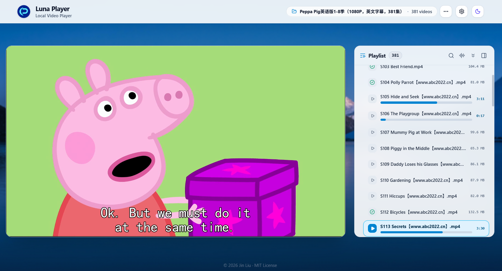
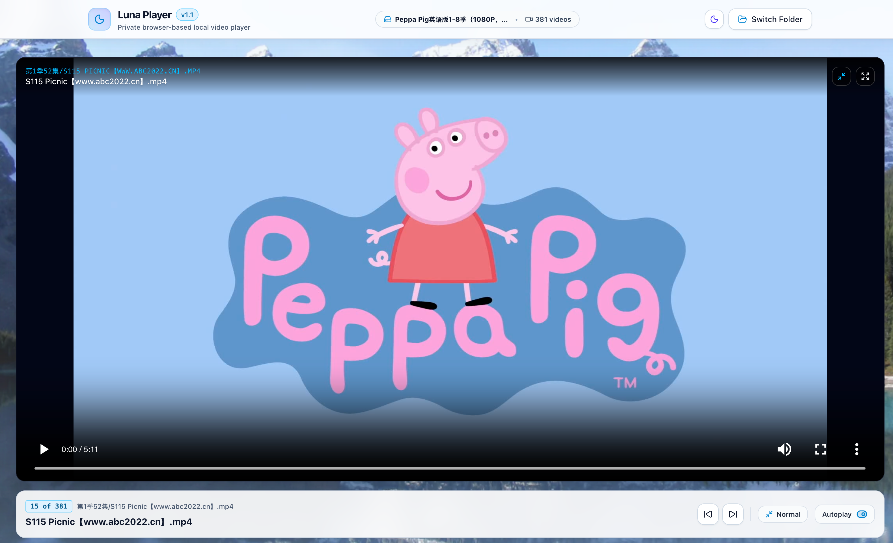

<p align="center">
  
</p>

<h1 align="center">Luna Player</h1>

<p align="center">
  <strong>A modern, lightweight, private browser-based local video player.</strong>
</p>

Open any local folder, automatically discover videos across nested subdirectories, browse them in a hierarchical playlist with natural sorting, and play them directly in your browser.

**Core Philosophy:** Simple, beautiful, private, and easy to use.

---

## 📸 Preview



### Modes & Layouts

| Dark Mode | Theater Mode |
| :---: | :---: |
|  |  |

---

## ✨ Features

- **🔒 100% Client-Side & Private**
  - Zero backend services, zero tracking, and zero cloud uploads.
  - Video streams are processed strictly in-browser via Blob Object URLs directly from local disk handles.
- **📂 Local Folder Discovery & Traversal**
  - Seamless folder selection via the modern **File System Access API** (`showDirectoryPicker`).
  - Graceful fallback to directory-enabled file picker (`webkitdirectory`) on unsupported browsers.
  - Automatically filters supported video formats (`.mp4`, `.webm`, `.mkv`, `.mov`, `.avi`, `.m4v`, `.ogv`).
  - Prunes empty folders and non-video files while preserving hierarchical nested directory structure.
- **🔢 Natural Sorting & Deterministic DFS Ordering**
  - Intuitively sorts video titles numerically (e.g., `Episode 1`, `Episode 2`, ..., `Episode 10`).
  - Deterministic Depth-First Search (DFS) playback sequencing traverses season folders sequentially.
- **▶️ Seamless Playback & Flow**
  - **Instant Selection Playback**: Clicking any episode in the playlist starts playback immediately without requiring secondary clicks.
  - **Autoplay-Next**: Automatically advances through episodes upon video completion.
  - **Continuous Navigation**: Dedicated Next/Previous controls maintain playback state.
  - **Pause/Resume**: Clicking the active video resumes playback.
- **💾 Playback Persistence**
  - Collision-proof library and video hashing preserves resume positions across browser sessions via IndexedDB.
  - Automatically restarts completed videos from the beginning.
- **🎭 Theater Mode & Fullscreen**
  - Expanded theater layout with auto-hiding floating overlays.
  - Native HTML5 video fullscreen support.
- **🎨 Glassmorphic Themes & Alpine Scenic Backdrop**
  - High-resolution Moraine Lake & alpine mountain photographic background.
  - Class-based Light and Dark themes with WCAG AA-conscious contrast and frosted-glass panels.
  - Persists theme preferences across sessions.
- **♿ Fully Keyboard Accessible**
  - Sequential Tab navigation reaches all player and overlay controls even when hidden.
  - Keyboard activation via `Enter` / `Space`.

---

## 🛠️ Technology Stack

- **Framework**: [React 19](https://react.dev/) + [TypeScript](https://www.typescriptlang.org/)
- **Build Tool**: [Vite 8](https://vitejs.dev/)
- **Styling**: [Tailwind CSS 4](https://tailwindcss.com/)
- **Icons**: [Lucide React](https://lucide.dev/)
- **Storage**: IndexedDB & LocalStorage
- **APIs**: HTML5 Video API, File System Access API
- **Testing**: [Vitest](https://vitest.dev/) (Unit) & [Playwright Test](https://playwright.dev/) (Chromium E2E)

---

## 🚀 Getting Started

### Prerequisites

- [Node.js](https://nodejs.org/) (v18.0.0 or higher recommended)
- `npm` (or `pnpm` / `yarn`)

### Local Development

Install dependencies and start the local development server:

```bash
npm install
npm run dev
```

Open `http://localhost:5173` in your browser.

### Production Build

Create an optimized static production build:

```bash
npm run build
```

Preview the production build locally:

```bash
npm run preview
```

---

## 🧪 Testing

### Unit Tests (Vitest)

Run the fast unit test suite covering natural sorting, video tree construction, DFS flattening, and playback progress persistence:

```bash
npm test
```

### End-to-End Tests (Playwright)

Run the full automated browser test suite against Chromium (includes directory picker mocks, real video playback verification, auto-hide overlay interactions, and visual regression checks):

```bash
npm run test:e2e
```

---

## 📁 Project Structure

```
luna-player/
├── docs/
│   ├── branding/              # Authoritative mascot design reference
│   └── screenshots/           # Application screenshots (overview, dark, theater)
├── public/
│   ├── favicon.svg            # Official vector mascot favicon
│   └── assets/                # Static alpine photographic backdrop
├── src/
│   ├── assets/                # Bundled backdrop assets
│   ├── components/            # UI components (Header, EmptyState, VideoPlayer, Playlist)
│   ├── hooks/                 # Custom React hooks (usePlayback, useTheme, useVideoLibrary)
│   ├── services/              # File system, directory traversal & IndexedDB storage
│   ├── types/                 # TypeScript interfaces
│   ├── utils/                 # Natural sort and tree traversal algorithms
│   ├── App.tsx                # Main application layout and state wiring
│   ├── index.css              # Tailwind utilities, class variants, glassmorphism
│   └── main.tsx               # React application entry point
├── tests/
│   ├── e2e/                   # Playwright E2E smoke and regression suites
│   ├── fixtures/              # Sample local library test video fixtures
│   └── *.test.ts              # Vitest unit test suites
├── LICENSE                    # MIT License
├── package.json
├── playwright.config.ts
├── tsconfig.json
├── vite.config.ts
└── vitest.config.ts
```

---

## 📄 License

This project is open-source and licensed under the [MIT License](LICENSE).
